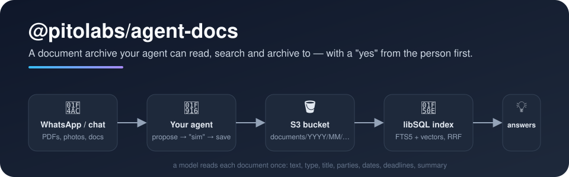

<p align="center">
  
</p>

<p align="center">
  <a href="https://www.npmjs.com/package/@pitolabs/agent-docs"></a>
  <a href="https://github.com/pitolabs/agent-docs/actions/workflows/ci.yml"></a>
  <a href="LICENSE"></a>
</p>

# 👋 Welcome to agent-docs

Give your AI agent a **filing cabinet with a memory**. People send it PDFs, photos and office documents in a chat; the
agent files them in a private S3 bucket (after the person says *yes* 👍), a model reads each one once, and from then on
the agent can answer *"when does the accountant's contract end?"* or *"find the October energy bill"* — by keyword, by
meaning, by date.

Built for [Mastra](https://mastra.ai) agents, with a framework-neutral core you can use anywhere.

## ✨ What you get

- 🗂️ **An S3 archive that never overwrites**: `documents/YYYY/MM/<kebab-name>.pdf`, a one-line description on each
  file, 7-day download links, an IAM policy of *list, get, put* and nothing else.
- 🧠 **One extraction per document**: full text as Markdown plus type, title, parties, date, deadlines and a summary —
  validated with a schema, never invented.
- 🔎 **Hybrid search in a single libSQL file**: FTS5 keywords (accents folded) + chunk vectors, fused by reciprocal
  rank, filtered by type, year or "a deadline before…".
- ✅ **A "yes" before anything is written**: `propose_file` shows what will happen; only the same person's next
  message, if it is just a *yes/ok/👍*, lets `save` run. Or skip it with `immediate: true`.
- 🧩 **Ready-made Mastra tools**: `received_files`, `propose_file`, `save`, `archive_file`, `list_documents`,
  `search_documents`, `read_document`, `document_link`.
- 🔌 **Pick your embedder**: any Mastra model id (`openai/text-embedding-3-small`), Amazon Bedrock, OpenRouter, or any
  OpenAI-compatible `/embeddings` (Ollama, vLLM, Azure…).
- 🔒 **Privacy by construction**: errors never carry document text; the index is pinned to its bucket and model.

## 🪶 Light, cheap, yours

- 🪶 **Lightweight**: three runtime dependencies (`@libsql/client`, `aws4fetch`, `zod`), 31 files, 117 kB unpacked, no
  native build, no vector database to run. The index is one SQLite file next to your agent.
- 💸 **Low cost**: one model call and one embedding pass per document, ever; searches are a keyword query and one
  query embedding. Storage is an S3 bucket you already have.
- 🧘 **Simple to run**: in-process, one file at a time; a crash or a restart only delays reading, the sweep catches up.
  No queue, no worker, no cron to install.
- 🔐 **Yours**: your bucket, your database file, your choice of where text goes (Bedrock keeps it in-region; a local
  OpenAI-compatible server keeps it on your machine). Delete the file and the index rebuilds itself from S3.

## 🚀 Quick start

```bash
bun add @pitolabs/agent-docs      # or: npm install @pitolabs/agent-docs
```

```ts
import { Agent } from "@mastra/core/agent";
import { ApprovalGate, archiveTools, DocsArchive, docsConfig, extractorAgent, extractWith, mastraEmbedder, openAgentIndex } from "@pitolabs/agent-docs/mastra";

const cfg = docsConfig("CLERK"); // CLERK_DOCS_BUCKET, _REGION, _AWS_ACCESS_KEY_ID, _AWS_SECRET_ACCESS_KEY
if ("off" in cfg) throw new Error(cfg.off);
const docs = new DocsArchive(cfg);
const embedder = mastraEmbedder("openai/text-embedding-3-small", { dims: 1536 }); // reads OPENAI_API_KEY
const extractor = extractorAgent({ model: "openai/gpt-4o-mini" });
const opened = await openAgentIndex({ url: "file:./docs-clerk.db", bucket: cfg.bucket, docs, embedder, extract: extractWith(extractor, "openai/gpt-4o-mini") });
if ("off" in opened) throw new Error(opened.off);
const gate = new ApprovalGate();

export const clerk = new Agent({
	id: "clerk",
	name: "Clerk",
	model: "openai/gpt-4o-mini",
	instructions: "You file the company's documents and find them again.",
	tools: archiveTools({ gate, docs, ...opened, embedder, where: "WhatsApp da empresa", archiveName: "no arquivo da empresa" }),
});
opened.indexer.start(); // reads what the bucket has and the index does not, now and every 6 h
```

Then, in whatever delivers messages to the agent, three lines per turn: `gate.onMessage(…)` (a *yes* approves, anything
else drops), `gate.setFiles(…)` (the turn's attachments) and `grantPass(requestContext, { conversation, sender })` (who
is writing). The [guide](docs/guide.md) walks through it.

## 📚 Learn more

| | |
|---|---|
| 📖 [Guide](docs/guide.md) | Wiring the gate and the pass, the tools one by one, `extra` and `keyFilter`, the extractor |
| 🔎 [Reference](docs/reference.md) | Embedders, where the index lives, the search, S3 layout and IAM, what is stored and where text goes |
| 🗺️ [Design notes](docs/design.md) | Why a libSQL file and not `@mastra/rag`, why the approval gate is code and not a prompt, what is planned |
| 🧑‍💻 [Contributing](CONTRIBUTING.md) | Hooks, formatting, tests, the privacy scan |

## 🌍 Languages

Tool descriptions, proposals and the extractor's prompt are in **Brazilian Portuguese** in this release (it was born
on WhatsApp in Brazil 🇧🇷). The prompt is one string you can replace (`extractorAgent({ instructions })`); an English
set is on the list.

## 💛 Made by Pito Labs

Extracted from the agents we run for our own businesses, family and health documents. MIT licensed — use it, fork it,
tell us what you built.
